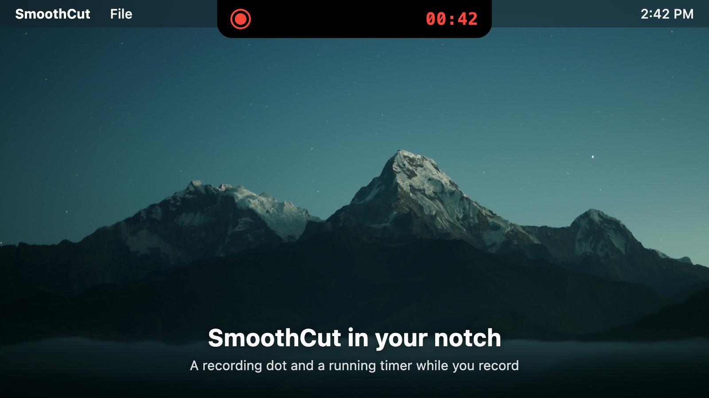
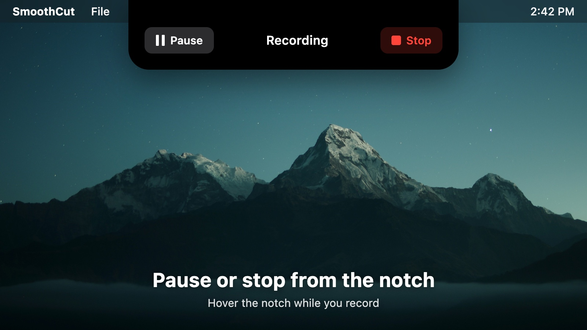

# SmoothCut for DynamicLake

See what [SmoothCut](https://smoothcut.studio) is doing without leaving what you're recording: your
recording time and export progress live in the notch, and you can pause or stop a recording from
there.





## What it shows

| When | In the notch | Hover (sneak peek) |
|---|---|---|
| Recording | A red record dot and a running timer | **Pause** · Recording · **Stop** |
| Paused | An orange paused badge and the time so far | **Resume** · Paused · **Stop** |
| Exporting | A progress ring | Exporting · the percentage |
| Export done | A green tick, for a few seconds | **Show in Finder** · Export complete |
| Export failed | A red failure badge, for a few seconds | Export failed |

When SmoothCut isn't recording or exporting, nothing is shown.

## Install

You need macOS with [DynamicLake](https://dynamiclake.com) (Pro or Playground) and
[SmoothCut](https://smoothcut.studio/download) 1.18 or later. SmoothCut is free to download and use.

1. In SmoothCut, open **Settings → AI assistants → Notch** and turn on
   **Show SmoothCut in the DynamicLake notch**.
2. Click **Add to DynamicLake**. SmoothCut saves the plugin to your Downloads folder and shows it in
   Finder. (Or download `SmoothCut-1.0.0.zip` from
   [Releases](https://github.com/charanjit-singh/smoothcut-dynamiclake/releases) and unzip it.)
3. In DynamicLake, open **Settings → Plugins → Install Local** and choose
   `SmoothCut.dynamiclakeplugin`.

Start a recording and it appears in the notch. If SmoothCut is closed, or the switch is off, the
plugin waits quietly and shows nothing.

## Privacy and safety

- **It only relays.** The plugin can't make SmoothCut do anything except what SmoothCut itself
  answers to: pause, resume, stop, and reveal the file you just exported.
- **Local only.** No network access. It talks to DynamicLake and to a socket in SmoothCut's own data
  folder that only your user account can open.
- **Writes nothing.** No temporary files, no settings, nothing inside the installed package.

## How it works

`smoothcut-dynamiclake.pl` is a relay and nothing else. DynamicLake starts it with
`DYNAMICLAKE_JSON_SOCKET`. Once SmoothCut's local socket exists (only while the switch above is on),
the script connects to both, sends SmoothCut a one-line hello carrying
`DYNAMICLAKE_PLUGIN_FEATURES`, and copies bytes both ways. The framing and the JSON
(`create` / `update` / `dismiss` and `action` callbacks) come from SmoothCut. When SmoothCut quits,
the script closes its DynamicLake connection, which takes the activity down, and waits for
SmoothCut to come back.

DynamicLake only trusts messages from the process it launched, so the script holds both
connections itself rather than handing them to a helper. It's Perl because every Mac ships
`/usr/bin/perl`, which can do that with modules that come with macOS; there's no Python or Node
to rely on.

## Package it yourself

The plugin package is these five files: `plugin.json`, `smoothcut-dynamiclake.pl`, `icon.png`,
`README.md` and `LICENSE`.

```sh
mkdir -p dist/SmoothCut.dynamiclakeplugin
cp plugin.json smoothcut-dynamiclake.pl icon.png README.md LICENSE dist/SmoothCut.dynamiclakeplugin/
chmod +x dist/SmoothCut.dynamiclakeplugin/smoothcut-dynamiclake.pl
cd dist && ditto -c -k --keepParent SmoothCut.dynamiclakeplugin SmoothCut-1.0.0.zip
shasum -a 256 SmoothCut-1.0.0.zip
```

## Support

Questions or problems: [hello@smoothcut.studio](mailto:hello@smoothcut.studio), or open an issue here.

## Licence

Copyright (c) 2026 Charanjit Singh. GPL-3.0, see [`LICENSE`](LICENSE): you may study, change and
share this plugin, and anything built from it must be released under the same licence, with this
notice kept.
